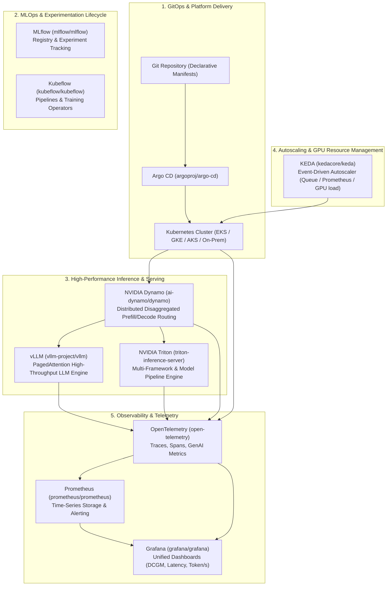

# Top 10 Open-Source Repositories for Modern AI & DevOps Engineers

A curated guide covering the transition from classic DevOps (**Docker → K8s → CI/CD**) to the modern AI/ML Platform stack (**AI Workloads → Model Serving → GPU Scheduling → AI Observability → Event-Driven Autoscaling**).

---

## Architecture Blueprint: The Modern AI Infra Stack

---

## 1. GitOps & Platform Engineering

### 1. [Argo CD](https://github.com/argoproj/argo-cd)
* **Repository**: [`argoproj/argo-cd`](https://github.com/argoproj/argo-cd)
* **Category**: Declarative GitOps Continuous Delivery
* **Role in AI Stack**:
  * AI infrastructure manifests (Helm charts, Kustomize overlays, operator CRDs for Ray, PyTorchJob, and Triton) must be declaratively synced with Git.
  * Ensures zero configuration drift across multi-tenant GPU training/inference clusters.
  * Provides automated canary/blue-green deployments for model-serving microservices.

### 2. [KEDA (Kubernetes Event-driven Autoscaling)](https://github.com/kedacore/keda)
* **Repository**: [`kedacore/keda`](https://github.com/kedacore/keda)
* **Category**: Event-Driven Workload Autoscaling
* **Role in AI Stack**:
  * Default Kubernetes HPA (CPU/Memory) is inadequate for LLM inference (where GPU VRAM is permanently pre-allocated by KV caches).
  * KEDA allows autoscaling GPU worker pods based on real inference metrics: queue length (Kafka, SQS, RabbitMQ), vLLM pending request metrics, or custom Prometheus time-series metrics.
  * Supports scaling to and from zero to save substantial GPU cloud costs.

---

## 2. MLOps Platforms & Model Lifecycle

### 3. [Kubeflow](https://github.com/kubeflow/kubeflow)
* **Repository**: [`kubeflow/kubeflow`](https://github.com/kubeflow/kubeflow)
* **Category**: End-to-End Cloud-Native ML Platform
* **Role in AI Stack**:
  * Operates directly on Kubernetes to automate distributed training (`TFJob`, `PyTorchJob`, `MPIJob` via Kubeflow Training Operator).
  * Manages ML DAGs with Kubeflow Pipelines (KFP) and handles multi-framework model serving with KServe (vLLM, Hugging Face, Triton backends).

### 4. [MLflow](https://github.com/mlflow/mlflow)
* **Repository**: [`mlflow/mlflow`](https://github.com/mlflow/mlflow)
* **Category**: Model Registry & ML Lifecycle Management
* **Role in AI Stack**:
  * Model governance, artifact versioning, hyperparameter experiment tracking, and LLM evaluation (`mlflow.evaluate`).
  * Integrates with CI/CD pipelines to trigger automated container building and GitOps sync when a model transitions from `Staging` to `Production`.

---

## 3. Production Model Serving & AI Inference Engines

### 5. [vLLM](https://github.com/vllm-project/vllm)
* **Repository**: [`vllm-project/vllm`](https://github.com/vllm-project/vllm)
* **Category**: High-Throughput LLM / VLM Inference Engine
* **Role in AI Stack**:
  * Industry standard for serving large language models with state-of-the-art throughput via **PagedAttention**, continuous batching, and chunked prefill.
  * Exposes OpenAI-compatible REST API endpoints out of the box.
  * Native support for tensor parallelism, pipeline parallelism, and speculative decoding.

### 6. [NVIDIA Triton Inference Server](https://github.com/triton-inference-server/server)
* **Repository**: [`triton-inference-server/server`](https://github.com/triton-inference-server/server)
* **Category**: Enterprise Multi-Framework Model Serving
* **Role in AI Stack**:
  * The production backbone for heterogeneous AI systems (supports PyTorch, ONNX, TensorRT, TensorRT-LLM, OpenVINO, Python).
  * Handles multi-model concurrency, dynamic batching, CPU/GPU sharing, and complex pipeline ensembles (e.g., preprocessing → embedding → cross-encoder re-ranking).

### 7. [NVIDIA Dynamo](https://github.com/ai-dynamo/dynamo)
* **Repository**: [`ai-dynamo/dynamo`](https://github.com/ai-dynamo/dynamo)
* **Category**: Distributed Disaggregated Inference Engine for LLMs
* **Role in AI Stack**:
  * Solves multi-node datacenter scale challenges for frontier reasoning models and deep contexts.
  * Provides **Disaggregated Serving**: separates the compute-bound *Prefill* phase (time-to-first-token) from the memory-bound *Decode* phase (inter-token latency) onto dedicated GPU pools.
  * Features intelligent KV-cache-aware request routing and prefix caching to minimize redundant GPU compute.

---

## 4. Observability for AI & Distributed Systems

### 8. [Prometheus](https://github.com/prometheus/prometheus)
* **Repository**: [`prometheus/prometheus`](https://github.com/prometheus/prometheus)
* **Category**: Cloud-Native Metrics Aggregation & Alerting
* **Role in AI Stack**:
  * Scrapes infrastructure metrics (`node_exporter`), GPU telemetry (`nvidia-dcgm-exporter`), and serving engine metrics (`vllm:num_requests_waiting`, `vllm:gpu_cache_usage_factor`).
  * Triggers real-time alerts on GPU thermal throttling, NVLink errors, and inference queue backlog spikes.

### 9. [Grafana](https://github.com/grafana/grafana)
* **Repository**: [`grafana/grafana`](https://github.com/grafana/grafana)
* **Category**: Operational Visualization & Analytics
* **Role in AI Stack**:
  * Visualizes GPU health (SM utilization, tensor core activity, memory bandwidth, temperatures) alongside application KPIs (Time-to-First-Token [TTFT], Tokens per Second [TPS], and P99 latency).

### 10. [OpenTelemetry](https://github.com/open-telemetry/opentelemetry-collector)
* **Repository**: [`open-telemetry/opentelemetry-collector`](https://github.com/open-telemetry/opentelemetry-collector)
* **Category**: Unified Telemetry Standard (Traces, Metrics, Logs)
* **Role in AI Stack**:
  * Powers end-to-end tracing across compound AI systems: user query → API gateway → guardrails → vector DB retrieval → reranker → LLM inference (vLLM/Triton) → response synthesis.
  * Establishes standardized GenAI semantic conventions (token usage tracking, prompt/completion attributes, agent step spans).

---

## Quick Comparison Table

| Tool | Primary Domain | Core Technology / Metric | Why DevOps Engineers Need It |
| :--- | :--- | :--- | :--- |
| **Argo CD** | GitOps | Kubernetes CRDs, Git sync | Declarative cluster orchestration and zero drift |
| **KEDA** | Autoscaling | Event triggers, Custom metrics | Scales GPU workers on queue depth & VRAM load |
| **Kubeflow** | MLOps Orchestration | Kubernetes native operators | Distributed fine-tuning, training, and KFP |
| **MLflow** | Lifecycle Management | Artifact registry, metadata tracking | Model versioning, lineage, and deployment gates |
| **vLLM** | LLM Inference | PagedAttention, Continuous Batching | Maximum tokens/sec per GPU for open-weights |
| **NVIDIA Triton** | Model Serving | Multi-backend, Dynamic batching | Enterprise multi-modal pipelines & heterogeneous runtimes |
| **NVIDIA Dynamo** | Distributed Serving | Disaggregated Prefill/Decode, KV routing | Multi-node cluster efficiency for frontier LLMs |
| **Prometheus** | Monitoring | PromQL, DCGM metrics | Scrapes hardware and inference engine telemetry |
| **Grafana** | Dashboards | Time-series visualization | Single pane of glass for GPU clusters and serving SLAs |
| **OpenTelemetry** | Tracing & Telemetry | Open standards, Span context | Traces complex multi-hop RAG and agent pipelines |
